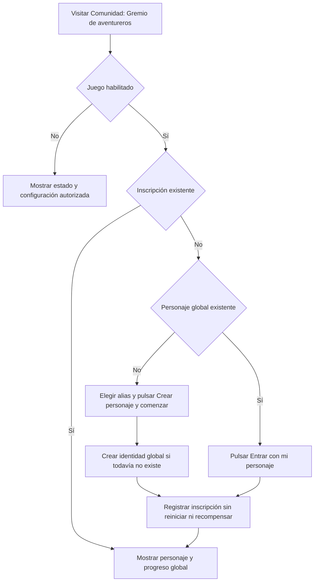

# Gremio de aventureros: primera entrega

La participación es voluntaria. Consultar la pantalla o habilitar el juego no crea personajes ni inscripciones.

## Datos

- `AdventureCharacter`: identidad y progreso global, únicos por ID de Discord. Alias editable, nivel inicial 1, rango F, experiencia y monedas en cero.
- `AdventureMembership`: inscripción por usuario y servidor, con nombre local opcional. No guarda copias del nivel, rango, experiencia o monedas.
- `AdventureConfig`: habilitación por servidor, desactivada por defecto. Solo propietarios o administradores nativos del servidor pueden cambiarla.

Los permisos de Discord no conceden ventajas dentro del juego. Incluso el propietario global del bot debe pertenecer al servidor para registrar su participación.

## Entrada

Las consultas no escriben datos. La inscripción es idempotente mediante índices únicos y operaciones de inserción condicional: repetirla no reinicia el personaje ni concede monedas. Si la identidad se creó pero la inscripción falló, un reintento reutiliza la identidad.

Los cambios de nombre usan versiones para detectar ediciones concurrentes desde varios servidores. La API identifica al jugador desde su sesión; no acepta un usuario destino ni cambios a estadísticas económicas o de progreso.

## Disponible y pendiente

Disponibles: habilitación administrativa, creación voluntaria, inscripción en varios servidores con el mismo progreso, consulta propia, alias global y nombre local.

Pendientes: expediciones, trabajos del worker, inventario, equipo, fabricación, tienda, misiones, recompensas, progresión, reputación y perfiles públicos, comandos de Discord. Las tarjetas de esas actividades indican «En preparación» y no ejecutan acciones ficticias.

La reputación futura y las recompensas deben tener reglas globales; cada servidor no puede multiplicar monedas ni experiencia mediante su configuración local.
