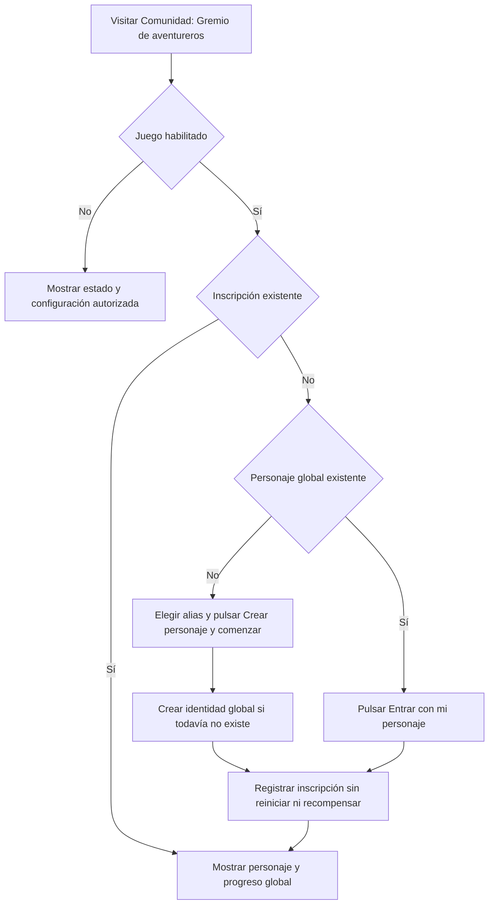

# Gremio de aventureros: primera entrega

La participación es voluntaria. Consultar la pantalla o habilitar el juego no crea personajes ni inscripciones.

## Datos

- `AdventureCharacter`: identidad y progreso global, únicos por ID de Discord. Alias editable, nivel inicial 1, rango F, experiencia y monedas en cero.
- `AdventureMembership`: inscripción por usuario y servidor, con nombre local opcional. No guarda copias del nivel, rango, experiencia o monedas.
- `AdventureConfig`: habilitación por servidor, desactivada por defecto. Solo propietarios o administradores nativos del servidor pueden cambiarla.

Los permisos de Discord no conceden ventajas dentro del juego. Incluso el propietario global del bot debe pertenecer al servidor para registrar su participación.

## Entrada

Las consultas no escriben datos. La inscripción es idempotente mediante índices únicos y operaciones de inserción condicional: repetirla no reinicia el personaje ni concede monedas. Si la identidad se creó pero la inscripción falló, un reintento reutiliza la identidad.

Los cambios de nombre usan versiones para detectar ediciones concurrentes desde varios servidores. La API identifica al jugador desde su sesión; no acepta un usuario destino ni cambios a estadísticas económicas o de progreso.

## Disponible y pendiente

Disponibles: habilitación administrativa, creación voluntaria, inscripción en varios servidores con el mismo progreso, consulta propia, alias global y nombre local.

Pendientes: expediciones, trabajos del worker, inventario, equipo, fabricación, tienda, misiones, recompensas, progresión, reputación y perfiles públicos, comandos de Discord. Las tarjetas de esas actividades indican «En preparación» y no ejecutan acciones ficticias.

La reputación futura y las recompensas deben tener reglas globales; cada servidor no puede multiplicar monedas ni experiencia mediante su configuración local.

## Diseños de objetos

En Comunidad > Gremio de aventureros > Diseños de objetos, los jugadores inscritos crean borradores globales privados. Pueden elegir ocho iconos de biblioteca o cargar PNG, JPEG o WebP de hasta 2 MB. La dashboard realiza recorte central con zoom a 256 por 256 y genera PNG; el backend valida firma, CRC, dimensiones, flujo comprimido y filtros, rechazando animaciones y formatos activos. Se almacena el PNG en el documento MongoDB del diseño, con límite de 512 KB, sin depender de adjuntos de Discord. La imagen no se incluye en las listas ni en los logs.

Los cosméticos pasan de borrador a enviado y después a aprobado o rechazado. Solo el propietario global del bot puede revisarlos; un administrador local no puede aprobar contenido global. La revisión no obliga al propietario a crear un personaje. Requiere abrir el juego en un servidor compartido con la modalidad habilitada. Los rechazos incluyen motivo, el creador puede corregir y volver a enviar. Los aprobados forman el catálogo global y quedan bloqueados para edición directa. Equipo, materiales y consumibles solo admiten borradores por ahora.

Las listas tienen diez resultados por página. Las imágenes privadas solo son visibles para su autor; las propuestas enviadas también para el revisor global y las aprobadas para los participantes. Guardar, enviar o aprobar un diseño nunca crea una unidad de inventario, cambia estadísticas ni entrega monedas. Los campos de daño, precio y recompensas no se aceptan en estas rutas.

### Catálogo visual predefinido
Los nuevos diseños usan exclusivamente el identificador de uno de ocho iconos de Game-icons.net. Los SVG se distribuyen localmente con el dashboard, incluyendo licencia y atribución a Lorc, Willdabeast y Delapouite (CC BY 3.0). Se retiraron la carga y el recorte de imágenes de la interfaz; la API rechaza `imageData` en altas y ediciones. Esta modalidad sustituye el flujo de carga descrito anteriormente. Las imágenes antiguas no se borran en masa; al guardar un borrador editable se sustituye su imagen por el icono elegido.
El acceso al juego también aparece directamente en cada tarjeta de servidor conectado y en la navegación del servidor. La activación sigue requiriendo propietario o Administrador de Discord.

### Entrada global al juego
La sección **Mi aventura** del sidebar abre `/adventure`, independiente de un servidor. `GET /api/adventure` no crea datos. `POST /api/adventure/start` crea voluntariamente un personaje global con alias y oficio (`hunter` o `merchant`), sin monedas ni membresías de regalo; reintentos y peticiones concurrentes conservan el personaje existente. `PATCH /api/adventure/character` permite editar alias y oficio con control de versión. Los personajes anteriores sin oficio pueden elegirlo sin perder progreso.
Unirse mediante `/guilds/:guildId/adventure/join` requiere un personaje existente, pertenencia real al servidor, presencia del bot y el juego habilitado por un administrador. El oficio por ahora es identidad, no implementa mecánicas de combate ni comercio. Las ciudades siguen pendientes.

### Integración opcional con Discord
En el servidor: **Gremio de aventureros > Integración con Discord > Configurar avisos del gremio**. Por defecto no se crean canales ni se envían avisos. Se puede seleccionar una categoría y un canal de texto existente dentro de ella. La acción explícita de creación crea `#avisos-del-gremio` en la categoría elegida, o crea también una categoría `Gremio de aventureros` si no se seleccionó ninguna. No mueve ni modifica canales existentes; los nuevos heredan permisos de su categoría. Crear recursos no activa los avisos: hay que guardar la configuración.
Solo administradores reales del servidor pueden delegar esta configuración a roles concretos. Los delegados pueden configurar el canal y crear los recursos solicitados, pero no delegar a otros ni activar el juego. El backend valida pertenencia, roles actuales, categoría del canal y permisos del bot. Se comparte el control de versión con la activación del juego.
Las nuevas inscripciones al juego guardan su aviso pendiente en el mismo documento de membresía (`$setOnInsert`): repetir la inscripción no genera avisos nuevos. El worker revisa la cola cada 15 segundos, respeta mantenimiento y servidores bloqueados, comprueba otra vez la integración y reintenta hasta cinco veces. Los mensajes no envían menciones y usan un nonce estable con `enforceNonce` para reducir duplicados en reintentos recientes. Discord limita temporalmente esa deduplicación; no es una garantía de entrega exactamente una vez ante fallos prolongados. Un fallo del aviso no revierte la inscripción. Desactivar avisos cancela los pendientes al procesarlos; no publica inscripciones antiguas retroactivamente. Los estados y errores de envío permanecen en MongoDB.
En esta entrega se publica la **inscripción al gremio del juego**, no el ingreso al servidor de Discord. Viajes, ciudades y avisos de llegada/salida siguen pendientes de implementar.

### Inventario, fabricación y compraventa global
**Mi aventura > Inventario y comercio** ofrece Inventario, Taller, Mercado global y Mis ofertas a ambos oficios. No exige un servidor ni otorga ventajas por permisos de Discord. Cambiar de oficio no reinicia materiales, monedas, ofertas ni el tiempo de recolección. Los diseños privados no se convierten en objetos automáticamente: solo los cosméticos aprobados tienen una receta global predefinida. No se permiten estadísticas, recetas, saldos ni propietarios enviados por el cliente.

Valores iniciales centralizados en `src/modules/adventure/economy-rules.ts`:
- Recolectar entrega 2 maderas y 2 hierbas cada 10 minutos; no concede monedas.
- Un amuleto de madera o cosmético aprobado requiere 2 maderas + 2 hierbas por unidad. Son cosméticos sin efectos de combate.
- Venta al sistema: madera 2 monedas, hierba 1, cosmético 5. Fabricar no genera arbitraje: los materiales cuestan 6 monedas al venderlos separados.
- Fabricación, venta y lotes: entre 1 y 100 unidades por operación. Precio de mercado: entero de 1 a 1 000 000 por unidad.
- Inventario: hasta 200 tipos de objeto, 1 000 000 unidades por tipo. Saldo: hasta 1 000 000 000 monedas por personaje.

Las ofertas reservan las unidades en depósito: salen del inventario disponible al publicarse. Se compran lotes completos; una compra transfiere monedas del comprador al vendedor y las unidades al comprador. No se pueden comprar ofertas propias ni cancelar ofertas ajenas. Cancelar devuelve el lote al vendedor; si no hay espacio, se conserva en depósito hasta que lo haya. Inventario y ofertas se paginan en la interfaz; el mercado y el catálogo aprobado paginan también en la API. No se implementaron comisiones, equipamiento, combate, efectos de consumibles ni bonificaciones por oficio.

Persistencia: `AdventureInventory`, `AdventureListing` y `AdventureReceipt`. `POST /api/adventure/economy/{gather,craft,sell,list,buy,cancel}` exige una clave de idempotencia por acción, limitada al usuario autenticado. Repetir la clave y el mismo contenido devuelve el comprobante guardado; cambiar su contenido produce conflicto. Los comprobantes no expiran. Las escrituras de inventario, saldo, oferta y comprobante se confirman juntas mediante transacciones MongoDB. **Se requiere replica set o Atlas**; una instancia standalone devuelve 503 sin recurrir a transferencias no atómicas. El arranque inicializa los índices únicos antes de aceptar peticiones. Se respeta el mantenimiento global para nuevas operaciones.

El dashboard confirma cantidades e importes antes de operar y conserva la clave al reintentar una respuesta incierta. Las actualizaciones usan Redux y consultas compartidas, sin botón manual de actualizar. La recolección tiene su propio reloj persistente por personaje, independiente del navegador o del oficio. No se introdujeron recompensas de registro retroactivas.

Verificación: pruebas unitarias y HTTP, dobles transaccionales con rollback y una prueba optativa contra MongoDB real (`test/adventure-economy.mongo.test.ts`). Esta última se activa con `ADVENTURE_ECONOMY_MONGO_TEST=1`, usa colecciones temporales con prefijo aleatorio `tmp_eco_`, desactiva la creación implícita de colecciones del aplicativo y elimina solo sus propias colecciones al terminar. Nunca debe apuntar a colecciones reales de jugadores.

### Países, viajes y mercados locales
Cada personaje tiene una sola ubicación (`currentGuildId`, con nombre descriptivo). Los personajes anteriores comienzan en el **Refugio neutral**, sin alterar su inventario, monedas ni membresías. `GET /api/adventure/world` devuelve los servidores conectados disponibles, el estado del juego y la inscripción del jugador. Los viajes son gratuitos e instantáneos; no se implementaron ciudades independientes ni aventuras en esta entrega.

`POST /api/adventure/economy/travel` requiere `{guildId, version, key}`. `guildId: null` vuelve al refugio sin exigir acceso al servidor anterior. Viajar a un país requiere presencia actual del bot, pertenencia real del usuario a Discord (también para el propietario del bot), juego habilitado e inscripción existente. El viaje no inscribe automáticamente ni cambia el inventario. Ubicación, comprobante de viaje y aviso pendiente se confirman juntos; reintentar la misma clave no repite el movimiento ni el aviso. Los viajes y el comercio respetan el mantenimiento.

Las nuevas ofertas guardan `guildId` y un nombre descriptivo. Publicar, comprar y vender al sistema requieren `{guildId}` y encontrarse en ese país. La ubicación se verifica dentro de la transacción, y las publicaciones también escriben el personaje para entrar en conflicto con un viaje simultáneo. Una escritura en la configuración del país serializa las operaciones con la desactivación del juego. Los permisos de Discord se revalidan antes de la transacción; como servicio externo, Discord no forma parte de la transacción de MongoDB.

`GET /api/adventure/economy/market?guildId=...` permite consultar un mercado accesible aunque el personaje esté en otro lugar. `?mine=true` muestra las ofertas propias de todos los países sin exigir acceso a sus servidores. Cancelar sigue siendo posible a distancia o tras perder acceso al país; los objetos reservados vuelven al mismo inventario, sujeto a sus límites de capacidad. Las ofertas heredadas sin país se muestran como **Mercado anterior**, permanecen reservadas y solo admiten cancelación por su propietario; no se reasignan ni se compran. No se realizaron migraciones destructivas ni se cancelaron ofertas automáticamente.

En **Mi aventura**, Países y viajes permite inscribirse desde el enlace al gremio, viajar y regresar al refugio. En cada gremio se abren viajes y mercado mediante modales. El selector del mercado permite consultar otros destinos; publicar desde el inventario siempre usa la ubicación actual, que se muestra en la confirmación. Cada oferta queda donde se publicó aunque el vendedor viaje.

En **Configurar avisos del gremio**, la opción de llegadas es independiente de las inscripciones. Si la integración ya está habilitada, las llegadas se permiten por defecto y pueden desactivarse. No se crea ningún canal por viajar. El worker procesa los avisos de los comprobantes, valida de nuevo categoría/canal/configuración, evita menciones y reintenta hasta cinco veces. Viajar al mismo lugar o regresar al refugio no publica una llegada en Discord. La deduplicación usa el comprobante persistente y un nonce estable de Discord; la ventana temporal de deduplicación de Discord sigue siendo una limitación ante fallos prolongados.

### Generación automática de aventuras
El worker del bot genera tres propuestas por país habilitado y las renueva cada seis horas. Usa plantillas procedurales versionadas, no un proveedor de IA. El nombre, lugar, tipo y duración se derivan del país y ciclo; sus reglas y premios son controlados por el servidor. Los tipos iniciales son reconocimiento, recolección y acompañamiento de caravanas. Dos propuestas requieren nivel 1 y una nivel 2. Los escenarios son narrativos, no crean ciudades ni canales de Discord.

Cada propuesta tiene dos etapas de 3 a 5 minutos. Al terminar la espera de cada etapa, el jugador elige:
- Cautela: 1 material y 4 de experiencia garantizados.
- Explorar a fondo: 65 % de obtener 3 materiales y 9 de experiencia; un contratiempo entrega solo 2 de experiencia. No se pierden objetos existentes ni monedas.
La primera etapa recoge madera y la segunda hierbas. No hay premios monetarios directos. La experiencia se entrega al finalizar; el nivel se calcula como `1 + floor(experiencia / 100)`, hasta nivel 100, sin disminuir niveles existentes. El rango no se promociona automáticamente.

Persistencia: `AdventureOffer` guarda propuestas, con clave única país/ciclo/plantilla. `AdventureRun` guarda una copia de la propuesta aceptada, etapa, espera, decisiones, premios pendientes y una semilla privada excluida de las respuestas. Existe un índice único parcial de una expedición activa por usuario, además del vínculo `activeAdventureId` en el personaje. Las propuestas aceptadas siguen funcionando aunque rote el tablón. Solo se muestra el historial propio de las cinco últimas aventuras terminadas o abandonadas; el historial persistido no se elimina.

`GET /api/adventure/expeditions[?guildId=...]` consulta tablón, aventura propia e historial sin crear datos. El worker prepara los tablones en lotes; tras habilitar un país pueden tardar uno o varios ciclos de 15 segundos en aparecer. `POST /api/adventure/expeditions/{start,decide,claim,abandon}` acepta claves de idempotencia. Inicio requiere una propuesta vigente, nivel suficiente, ubicación correcta, inscripción y acceso real a Discord. Las decisiones, esperas y premios los valida el backend. La semilla privada determina cada resultado de forma estable: reintentar no permite cambiarlo.

Una aventura activa bloquea viajar y la recolección directa. La gestión del inventario y las ofertas conserva sus reglas anteriores; permite liberar capacidad antes de recoger premios. Las recompensas no entran al inventario hasta `claim`. Si falta espacio, se conserva la aventura lista y sus premios pendientes. Reclamar, acreditar materiales/experiencia y cerrar la aventura se confirman en una transacción. Abandonar descarta los premios pendientes, conserva las pertenencias y mantiene la espera hasta el fin previsto del recorrido inicial, para impedir reinicios inmediatos en busca de mejores resultados.

Cerrar el navegador no reinicia el reloj de la etapa actual; las siguientes etapas comienzan al tomar la decisión correspondiente. Una aventura aceptada puede completarse o abandonarse incluso si se pierde acceso al país, para no bloquear al personaje ni perder recompensas por un fallo de Discord. Después puede regresar al refugio. El mantenimiento pausa las nuevas acciones, sin borrar progreso. No se implementaron combate por turnos, grupos, equipo con estadísticas ni ventajas por oficio.

Interfaz: **Mi aventura > Aventuras del gremio**, y **Gremio de aventureros > Ver aventuras del gremio** mediante modal. El contador se actualiza localmente y la consulta compartida de Redux se comprueba cada 15 segundos mientras está visible. La interfaz exige confirmación para iniciar o abandonar y conserva la clave de una solicitud incierta al reintentar. El bot genera propuestas; nunca acepta aventuras ni decide por un usuario.

Prueba optativa real: `test/adventure-expeditions.mongo.test.ts`, con `ADVENTURE_EXPEDITION_MONGO_TEST=1`. Crea y elimina únicamente colecciones aisladas con prefijo aleatorio `tmp_exp_`, comprobando aceptaciones/decisiones/recompensas concurrentes, restricciones de espera, privacidad, reversión ante fallos y abandono sin premios.
