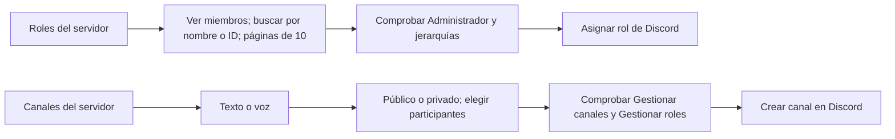

# Flujo de soporte y revisión de las implementaciones recientes

Revisión del código del 2 de noviembre de 2026. Describe lo implementado; las propuestas se distinguen de las funciones disponibles. No sustituye una prueba del recorrido con Discord y MongoDB reales.

## Flujo implementado

La consulta de ayuda es opcional: el usuario también puede enviar directamente una solicitud desde la dashboard o el selector del panel. Enviar una solicitud no crea un canal.

```mermaid
flowchart TD
    SETUP["Moderador o administrador publica respuestas y panel"] --> CATEGORY["Magelina crea o reutiliza la categoria Soporte del gremio y publica el panel dentro"]
    CATEGORY --> ENTRY["Usuario entra desde Discord o la dashboard"]
    ENTRY --> HELP{"¿Consulta la autoatención?"}
    HELP -->|Sí| FAQ["Lee respuestas publicadas por el equipo"]
    FAQ --> SOLVED{"¿Resolvió su duda?"}
    SOLVED -->|Sí| END["Finaliza sin crear caso"]
    SOLVED -->|No| FORM["Selecciona tipo de reporte y envia asunto y descripcion"]
    HELP -->|No| FORM
    FORM --> PENDING["MongoDB: solicitud pendiente; un caso activo por usuario"]
    PENDING --> ADMIN["Administrador revisa la cola en la dashboard"]
    ADMIN --> DECIDE{"¿Asigna atención?"}
    DECIDE -->|No; cierra solicitud| CLOSED["Caso resuelto en MongoDB"]
    DECIDE -->|Sí| ASSIGN["Administrador elige un moderador verificado"]
    ASSIGN --> NAMED["Canal privado bajo Soporte del gremio: soporte-usuario-tipo-id"]
    NAMED --> CREATE{"¿Se confirma el canal privado?"}
    CREATE -->|No| UNCERTAIN["Resultado incierto: requiere revisión manual"]
    CREATE -->|Sí| ATTEND["Usuario y moderador conversan; administradores conservan acceso"]
    ATTEND --> ESCALATE{"¿Requiere intervención?"}
    ESCALATE -->|Sí| ESC["Moderador registra motivo y escala al administrador"]
    ESC --> INTERVENE["Administrador interviene, reasigna o resuelve"]
    INTERVENE -->|Continuar atención| ATTEND
    INTERVENE -->|Resolver| CLOSED
    ESCALATE -->|No; continúa| ATTEND
    ATTEND -->|Moderador asignado o administrador resuelve| CLOSED
    CLOSED --> CHANNEL{"¿Existe canal de atención?"}
    CHANNEL -->|No| RECORD["Consulta del registro del caso"]
    CHANNEL -->|Sí| ARCHIVE{"¿El equipo confirma archivar y eliminar?"}
    ARCHIVE -->|Todavía no| KEEP["Canal permanece; conversación aún depende de Discord"]
    KEEP --> ARCHIVE
    ARCHIVE -->|Sí| LOCK["Canal en lectura y bloqueo de operación"]
    LOCK --> SAVE["Guarda mensajes e hilos en MongoDB; adjuntos en GridFS"]
    SAVE --> COMPLETE{"¿Archivo confirmado y sin mensajes nuevos?"}
    COMPLETE -->|No| SAFE["Conserva el canal y muestra el error"]
    SAFE -->|Reintentar tras revisar| ARCHIVE
    COMPLETE -->|Sí| DELETE{"¿Discord confirma la eliminación?"}
    DELETE -->|No| RETRY["Historial guardado; permite reintentar eliminación"]
    RETRY --> ARCHIVE
    DELETE -->|Sí| HISTORY["Historial y adjuntos disponibles en la dashboard"]
```

## Visibilidad y responsabilidades

| Persona | Acceso actual |
| --- | --- |
| Usuario | Ayuda pública del gremio, sus solicitudes, conversación y archivos de sus propios casos. No crea el canal ni asigna moderadores. |
| Moderador | Puede publicar ayuda y panel. Consulta sus solicitudes propias y los casos que le asignen; en estos últimos atiende, escala, resuelve y archiva/elimina el canal. |
| Administrador | Revisa todos los casos, asigna o reasigna, interviene, resuelve y archiva. Ve listas de moderadores y usuarios con pendientes. |
| Magelina | Comprueba permisos actuales, guarda registros y ejecuta las operaciones autorizadas en Discord. |

Administrador significa permiso nativo Administrador de Discord, propietario del gremio o propietario global del bot; no basta con que un rol se llame Administrador o tenga ese tipo en Magelina.

Los resueltos siguen visibles según estos permisos aunque se elimine su canal. Al seleccionar Resueltas se omite el filtro de casos activos; se mantiene, si existe, el filtro de persona.

## Qué se conserva y cuándo

| Momento | MongoDB | Discord |
| --- | --- | --- |
| Solicitud | Asunto, descripción, solicitante, estado e historial de acciones. | No se crea canal privado. |
| Asignación y atención | Responsable, canal, estados e historial de acciones. | Conversación; la dashboard consulta los últimos 50 mensajes en vivo. |
| Resolver | Estado cerrado; libera el límite de caso activo. | El canal permanece. Resolver no dispara el archivo de la conversación ni pone el canal en lectura. |
| Archivar y eliminar | Una captura de los mensajes disponibles, hilos y adjuntos; metadatos del archivo y eliminación. | Se bloquea la escritura habitual, se confirma el archivo y se intenta eliminar el canal. |
| Después de eliminar | Historial paginado y descargas autenticadas de adjuntos. | Ya no se necesita el canal para consultar el historial. |

El archivo no recupera mensajes que se hayan eliminado previamente de Discord ni conserva todas las versiones históricas de mensajes editados. Imágenes remotas de embeds y stickers se conservan como referencias/metadatos; los adjuntos descargados se guardan como archivos en GridFS.

## Falencias y propuestas

| Prioridad | Hallazgo en el código actual | Consecuencia | Propuesta, aún no implementada |
| --- | --- | --- | --- |
| Alta | No hay aviso de nueva solicitud ni de escalamiento al administrador. La notificación de asignación sí se intenta en el canal privado. | El administrador puede no enterarse si no abre la dashboard. | Bandeja o canal privado de avisos, con enlace al caso y registro de entrega/reintento. |
| Alta | Resolver y archivar son acciones independientes; solo la segunda conserva la conversación. El bloqueo de escritura también ocurre al archivar. | Un caso resuelto puede seguir recibiendo mensajes en Discord y quedar sin respaldo si su canal se borra por fuera de Magelina. | Al resolver, poner en lectura e iniciar el archivo. Mantener la eliminación como acción posterior, condicionada al respaldo confirmado. |
| Alta | El archivo completo corre dentro de una petición HTTP, aunque tiene bloqueo, heartbeat y recuperación del bloqueo tras cinco minutos sin actividad. | Archivos grandes o muchos mensajes pueden superar el tiempo del navegador/proxy. | Trabajo persistente en segundo plano, con progreso, estado y reanudación. |
| Alta | Una asignación fallida queda en estado incierto; no existe una acción para reparar y continuar ese caso. Si el proceso se interrumpe publicando el panel, su bloqueo no tiene recuperación por vencimiento. | Puede requerirse intervención manual sobre registros/canales. | Herramientas administrativas para verificar y vincular el canal existente, reparar el panel y continuar sin duplicar canales. |
| Media | No hay cancelación por el solicitante, reapertura ni motivo obligatorio de resolución. | Un usuario puede quedar bloqueado por su solicitud activa; un cierre prematuro exige otro caso. | Cancelar pendientes, guardar una resolución y permitir pedir reapertura con motivo. |
| Media | El contenido histórico depende de lo que Discord todavía entregue al archivar. | Mensajes borrados previamente no se recuperan. | Si se necesita esa trazabilidad, incorporar respaldo incremental de la conversación y una política explícita sobre ediciones y borrados. |
| Media | No hay limpieza de capturas incompletas/anteriores ni política automática de conservación o cuotas de adjuntos. | El almacenamiento puede crecer con reintentos y uso continuado. | Retención configurable y limpieza que nunca borre el único archivo confirmado. |
| Baja | Hay estados heredados y límites iniciales, como `open` y cinco respuestas de autoatención. | Aumenta la complejidad o limita el contenido del equipo. | Revisar datos antes de migrar `open`; ampliar la ayuda con categorías/páginas cuando haga falta. |

La validación con Discord real sigue siendo necesaria, especialmente para contenido de mensajes, hilos privados, adjuntos, permisos y reintentos tras interrupciones.

## Qué mantendría y qué simplificaría

- Mantener la revisión y asignación administrativa: es una decisión de este flujo. Para evitar que se estanque, añadir avisos, antigüedad y administradores de respaldo; no sustituirla por autoasignación sin cambiar primero esa decisión.
- Mantener la autoatención opcional: no obligar al usuario a atravesar respuestas que no resuelven su problema.
- Mantener la protección de no eliminar sin respaldo, los controles de versión y los bloqueos de operaciones.
- Mantener separados el estado del caso y el estado del archivo: resuelto no significa archivado ni canal eliminado.
- No retirar sin más el campo `active`: actualmente participa en el índice que impide dos casos activos del mismo usuario. Si se elimina, hay que sustituir esa garantía.
- Simplificar el cierre para el equipo: una acción que resuelva e inicie el archivo, y una acción posterior para eliminar el canal. Evitar duplicar pasos de atención en Discord y dashboard; ambos deben operar sobre el mismo caso.

## Funciones relacionadas, independientes del soporte

Estos canales generales no son casos de soporte y no deberían heredar automáticamente su cierre, archivo ni eliminación. Las listas y búsquedas de miembros usan la caché de Redux; la interfaz de roles actualiza la lista para detectar nuevos miembros.

## Orden sugerido

1. Avisos al administrador y cola de escalados.
2. Cierre con archivo automático en segundo plano y borrado posterior.
3. Reparación de operaciones inciertas e interrumpidas.
4. Cancelación, reapertura y resolución documentada.
5. Retención, limpieza y métricas de tiempos de atención.

## Código revisado

- [Solicitudes, asignaciones y permisos](src/modules/support/service.ts)
- [API de soporte y cierre](src/modules/support/routes.ts)
- [Panel de Discord](src/modules/support/panel.ts)
- [Interacciones del usuario](src/bot/support.ts)
- [Archivo y eliminación](src/modules/support/transcript.ts)
- [Datos del caso](src/database/models/SupportTicket.ts)
- Dashboard: `../dashboard_magelina/src/components/GuildSupport.tsx`, `SupportOverview.tsx` y `SupportHelp.tsx`.

Los tipos disponibles son Consulta general, Problema técnico, Acceso y permisos, Reporte de usuario y Otro. El tipo se guarda con el caso. Los casos anteriores se interpretan como Consulta general. Al mover canales bajo la categoría se conservan sus permisos propios; los casos privados no heredan acceso público. Publicar otra vez reutiliza la categoría y actualiza el panel.
